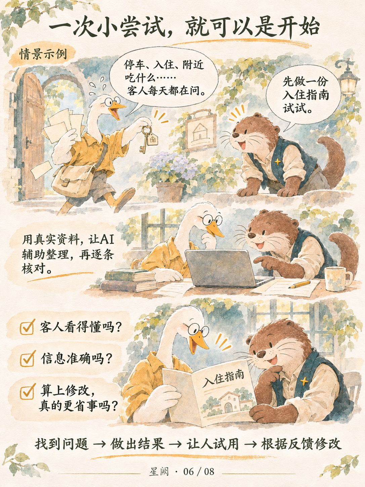

# 星阙水彩动物漫画

给一句场景、一段故事或一张待修改的旧图，用同一套水彩画风制作漫画。它适合画公众号封面、单幅插图和连续分镜：换一个故事，水獭仍穿着胸前带黄星的蓝绿马甲，白鹅也还戴着那副细圆眼镜。

## 先看画风

| 画风参考 | 角色参考 |
| --- | --- |
|  |  |
| 看纸纹、留白、笔触，以及分镜如何随动作变化。 | 看角色的体形、衣着和表情，让同一个角色在不同画面里依然好认。 |

## 在 Codex 中使用

1. [下载完整技能 ZIP](https://github.com/dxu20334-lang/xingque-watercolor-comic/archive/refs/heads/main.zip)，解压后找到直接包含 `SKILL.md`、`agents` 和 `assets` 的文件夹。
2. 将这个文件夹重命名为 `xingque-watercolor-comic`，放进项目根目录的 `.agents/skills/`。如果想在自己的多个项目里使用，也可以放进用户目录的 `.agents/skills/`。Windows 用户可在资源管理器地址栏输入 `%USERPROFILE%` 打开用户目录。[Codex 技能目录说明](https://developers.openai.com/codex/skills/)
3. 在 Codex 对话里输入下面这句。实际出图需要当前环境具备能读取参考图的图像生成工具；修改旧图时，还要附上原图并使用支持图像编辑的工具。

> 用 $xingque-watercolor-comic 画一张 3:4 的无字漫画。雨刚停，白鹅把收拢的最后一把纸伞递给水獭。水獭伸爪接住竹柄，身旁的伞架刚好空了一格。

## 换成你的题材

**做封面。** 给出一个关键动作，再说清哪里要留给标题。例如：“水獭在小餐馆的桌上展开菜单样稿，白鹅凑近看。画一张横版封面，左上留白，我会自己加标题。”

**讲连续故事。** 指定每张图里发生的变化。例如：“画两张。第一张，水獭把菜单样稿递给店主；第二张，店主指着被裁掉一半的菜品照片，水獭在同一张样稿上圈出要改的地方。”

**局部修图。** 附上旧图，指出要改的位置并给出准确文字。例如：“只改右下角招牌，把‘星阕’改成‘星阙’，保留招牌的木纹和旁边的角色。”导出后放大核对实际字形。

如果还在想故事，可以先要求“只给中文分镜和出图提示词”。完整的创作与校对步骤见 [SKILL.md](SKILL.md)。
